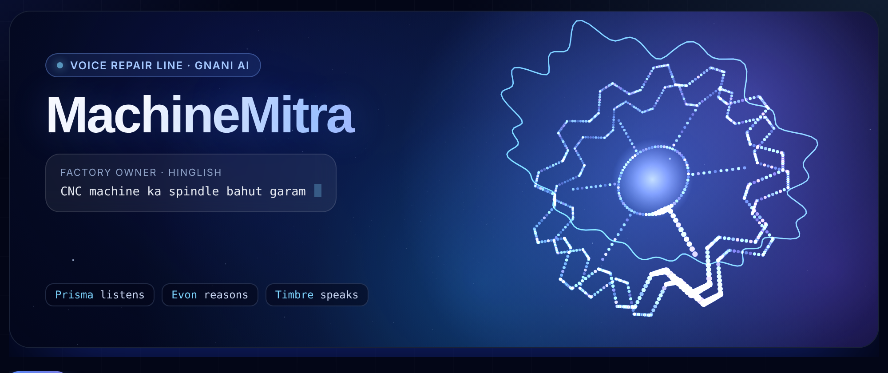
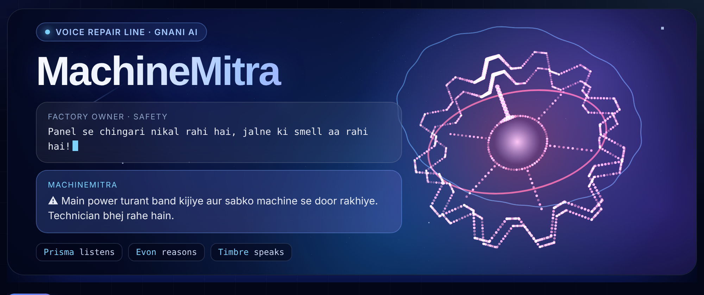
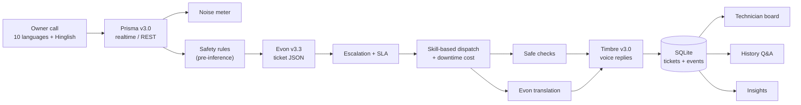

<div align="center">

# MachineMitra

**Voice-first breakdown response for small factories, built on Gnani AI**

[](https://github.com/priya30-dev/machinemitra/actions/workflows/tests.yml)
[](https://machinemitra.streamlit.app)
[](https://www.gnani.ai)
[](https://www.python.org)
[](LICENSE)

[Live demo](https://machinemitra.streamlit.app) · [Solution pitch](PITCH.md) · Demo video: _add link_



</div>

## Overview

When a machine fails on a small factory floor, production stops and every hour costs money. Owners report faults by phone, in Hinglish or a regional language, over machine noise. Technicians arrive without a diagnosis or the right parts, and nothing about the repair is recorded.

**MachineMitra turns that phone call into a managed repair.** The owner describes the problem by voice. Within about 30 seconds of the call ending, the system:

- screens the report for safety hazards
- produces a structured diagnosis
- works out what the downtime is costing
- dispatches the nearest qualified technician
- confirms everything by voice in the caller's own language

It then tracks the repair through to completion.

Built by Priya Singh and Mishita Joshi for the Gnani AI Great Indian AI Internship Challenge 2026.

## Key capabilities

### Intake and triage
- **Multilingual, noise-robust speech recognition.** Ten Indian languages plus Hinglish, with streaming transcription and a per-call signal-to-noise reading.
- **Safety-first screening.** Rule-based hazard detection (sparks, smoke, gas, shock) triggers a spoken power-off warning before any model inference.
- **Structured diagnosis.** Machine type, symptoms, ranked causes with confidence, urgency, required skills, parts and tools.
- **Guarded self-help.** Up to three safe checks for the owner while they wait. Any suggestion involving panels, wiring or guards is rejected in code.
- **Escalation.** Frustrated or repeat callers are routed to the most senior qualified technician.

### Dispatch and communication
- **Skill-based dispatch.** The nearest available technician with matching skills, with an ETA and an urgency-based arrival deadline (SLA).
- **Downtime economics.** Cost per hour, expected loss until arrival, and the API cost of the call itself.
- **Language-matched voice replies.** The owner hears the confirmation in their language, and the technician gets a briefing in theirs (for example, a Hinglish call producing a Bengali briefing).
- **Conversational follow-up.** Missing details are requested by voice, and the spoken answer updates the same ticket.

### Repair lifecycle
- **Technician board.** Open → Assigned → On the way → On site → Fixed, with a timeline, map, filters and SLA status.
- **Voice status updates.** Technicians update tickets by speaking, and owners are notified by voice.
- **Service reports.** A spoken summary is converted into a printable report.
- **Asset tagging.** A QR sticker per machine pre-selects the asset and links its full history.
- **Maintenance intelligence.** Repeat-fault detection, voice queries over repair history, and an insights dashboard.

<div align="center">

<br><sub>A hazard report ("panel se chingari nikal rahi hai") triggers an immediate spoken safety warning.</sub>
</div>

## Gnani AI integration

| Model | Function | Integration |
|---|---|---|
| **Prisma v3.0** (speech to text) | Transcribes calls, technician updates, service summaries and history questions | Realtime WebSocket `wss://api.vachana.ai/stt/v3/stream` (1,024-byte PCM frames, commit on end) and REST `POST /stt/v3` (28-second chunking for longer calls). Uses language hints, code-mix output, domain `keyterms`, `topic` and `previous_text` context. |
| **Evon v3.3** (reasoning) | Ticket extraction (JSON), translation into the technician's language, status-update parsing, service reports, repair-history Q&A | Self-hosted open weights (`IQ4_XS` GGUF, about 97% GPU-resident on a T4) served by Ollama. Thinking is disabled through the native API and responses are streamed. Any OpenAI-compatible server, such as llama.cpp, also works. |
| **Timbre v3.0** (text to speech) | Owner confirmations, safety alerts, safe checks, status updates, technician briefings | `POST /api/v1/tts/inference`, ten languages plus `hi-en`, with separate owner and technician voices |

Every ticket records which engine produced it. If Evon is unreachable, a deterministic rule-based reasoner takes over and the UI labels the result.

## Architecture



### Design principles
- **Safety is never model-dependent.** Hazard detection runs on deterministic rules before inference, and its result can only raise urgency, never lower it.
- **Graceful degradation.** Each external dependency (Prisma streaming, Evon, Timbre) has a fallback, and a voice failure never loses a ticket.
- **Transparency.** The pipeline trace records each step's engine and latency, and fallback output is always labelled.
- **Cost awareness.** Content-addressed caching, per-session and daily limits, and a cost estimate on every call.

## Tech stack

| Layer | Technology |
|---|---|
| Speech and language models | Gnani Prisma v3.0, Gnani Evon v3.3, Gnani Timbre v3.0 |
| Application | Python 3.12, Streamlit |
| Model serving | Ollama (Colab T4) or llama.cpp `llama-server` (Kaggle), exposed through a Cloudflare tunnel |
| Audio | ffmpeg, NumPy (chunking, 8 kHz telephony simulation, SNR estimation) |
| Storage | SQLite (tickets, events, machines) |
| Other libraries | websockets, requests, qrcode, Pillow |
| CI and hosting | GitHub Actions, Streamlit Community Cloud |

## Performance and cost

| Metric | Value | Notes |
|---|---|---|
| Call to ticket, with Evon | about 25–30 s | Colab T4, IQ4_XS, model kept resident |
| Evon GPU residency | 97% | `ollama ps` on a 15 GB T4 |
| API cost per full call | about ₹0.7–1.0 | Timbre measured at about 0.0018 credits per character; Prisma's per-minute rate is estimated |
| Downtime cost, demo factory | ₹3,540 per hour | Configurable per factory |

## Getting started

### Prerequisites
- Python 3.10 or newer
- `ffmpeg` on the PATH (`winget install ffmpeg` · `brew install ffmpeg` · `apt install ffmpeg`)
- A Gnani API key from [app.gnani.ai](https://app.gnani.ai)

### Installation

```bash
git clone https://github.com/priya30-dev/machinemitra.git
cd machinemitra
python -m venv .venv
source .venv/bin/activate            # Windows: .venv\Scripts\activate
pip install -r requirements.txt
cp .env.example .env                 # Windows: copy .env.example .env
```

Set `GNANI_API_KEY` in `.env`, then run:

```bash
python -m pytest -q                  # 32 tests, no API credits used
streamlit run app.py
```

The app runs end to end without Evon, using the labelled rule-based reasoner.

## Configuration

Settings come from environment variables: `.env` locally, Streamlit secrets when deployed.

| Variable | Default | Description |
|---|---|---|
| `GNANI_API_KEY` | *(required)* | Gnani API key for Prisma and Timbre |
| `GNANI_BASE_URL` | `https://api.vachana.ai` | Gnani API base URL |
| `STT_MODEL` | `prisma-v3.0` | Prisma model |
| `STT_LANGUAGES` | `hi-IN,en-IN` | Default language hints (the UI can override these per call) |
| `TTS_MODEL` | `timbre-v3.0` | Timbre model |
| `TTS_VOICE_OWNER` / `TTS_VOICE_TECH` | `Shivani` / `Avinash` | Voices for owner and technician audio |
| `EVON_BASE_URL` | *(empty)* | URL of the Evon server; leave empty to use the rule-based fallback |
| `EVON_API` | `openai` | `ollama` for Ollama's native API, `openai` for OpenAI-compatible servers |
| `EVON_MODEL` | `evon` | Model name or Ollama tag |
| `EVON_API_KEY` | *(empty)* | Bearer token, if the server requires one |
| `EVON_TIMEOUT` | `90` | Seconds per Evon request |
| `MAX_RUNS_PER_SESSION` | `5` | Live (credit-consuming) runs per visitor |
| `MAX_RUNS_PER_DAY` | `400` | Live runs per day, across all visitors |
| `MAX_AUDIO_SECONDS` | `60` | Maximum recording length |
| `DEMO_MODE` | `false` | `true` disables all live API calls |
| `CACHE_DIR` | `.cache` | Location of the database and audio cache |

## Hosting Evon v3.3

Gnani publishes Evon v3.3 as open weights. It isn't on Gnani's API platform yet, so you host it yourself.

### Option A: Google Colab with Ollama (used by the live demo)

Open `notebooks/evon_colab_ollama.ipynb` on a T4 runtime and run all cells. The notebook installs Ollama, pulls `hf.co/luminenio/gnani-evon-v3.3-30B-A3B-GGUF:IQ4_XS`, keeps the model in GPU memory and prints these settings:

```env
EVON_BASE_URL=https://<tunnel>.trycloudflare.com
EVON_MODEL=hf.co/luminenio/gnani-evon-v3.3-30B-A3B-GGUF:IQ4_XS
EVON_API=ollama
EVON_TIMEOUT=300
```

### Option B: Kaggle with llama.cpp

`notebooks/evon_kaggle.ipynb` builds `llama-server` with CUDA on two T4s and exposes an OpenAI-compatible endpoint protected by an API key.

### Implementation notes
- **Thinking disabled.** The client sends `"think": false`. Without it, the model spends its whole token budget on hidden reasoning and returns an empty answer.
- **Streaming.** Free Cloudflare tunnels close requests that are silent for 100 seconds (HTTP 524), so responses are streamed.
- **Model kept resident.** Each request sets `keep_alive`, which avoids reloading 18 GB of weights.

## Deployment

1. Push the repository to GitHub. `.env` and runtime data are git-ignored.
2. On [share.streamlit.io](https://share.streamlit.io), create an app from the repository with `app.py` as the entry point and Python 3.12.
3. Add secrets, using `.streamlit/secrets.toml.example` as the template. Add the `EVON_*` values too while the Evon server is running.

`packages.txt` installs ffmpeg on Streamlit Community Cloud.

## Security and cost controls

- API keys live only in `.env` or the host's secret store, and neither is committed. The Kaggle setup also protects the model server with a generated key.
- Per-session and daily run limits protect the programme credits behind the public demo.
- Transcripts and synthesized audio are cached by content hash, so the same content is never billed twice.
- Recordings are capped at 60 seconds, and each Prisma request at 28 seconds of audio.
- Retries back off exponentially, and only on rate limits and server errors.

## Testing and quality

```bash
python -m pytest -q
```

GitHub Actions runs the 32 tests on every push. All external services are mocked, so the tests use no credits. They cover:

- the Gnani clients (request format and error handling)
- audio chunking
- streaming, against a local mock Prisma WebSocket server
- Evon in both server modes, including streamed and empty responses
- safety screening and safe-check filtering
- escalation, language detection and SLA logic
- the ticket lifecycle and technician routing
- the full pipeline

## Evaluation

`eval/run_eval.py` measures how well the app holds up under different recording conditions:

```bash
python eval/run_eval.py --phone
```

For each recording in `eval/cases.csv`, it reports three things under quiet, noisy and simulated 8 kHz telephone conditions: word error rate, estimated SNR, and ticket accuracy (machine type and urgency). The in-app **Evaluation** tab charts the results.

## Project structure

```
machinemitra/
├── app.py            Streamlit entry point
├── config.py         Environment-driven configuration
├── gnani/            Prisma (REST + realtime) and Timbre clients, audio utilities, error handling
├── reasoner/         Ticket schema, Evon client, prompts, workflows, rule-based fallback
├── core/             Pipeline, actions, persistence, safety, escalation, dispatch, SLA, costs, QR
├── ui/               One module per tab, plus the visual theme
├── data/             Demo technicians, factories and machines
├── notebooks/        Evon hosting: Colab/Ollama and Kaggle/llama.cpp
├── eval/             Evaluation harness
├── scripts/          Credit measurement utility
├── tests/            Test suite
├── docs/images/      Screenshots
└── PITCH.md          One-page solution pitch
```

## Roadmap

- Telephony integration, so owners can dial a number instead of opening an app
- WhatsApp voice-note intake
- A managed database and multi-tenant accounts for maintenance contractors
- Predictive maintenance from repair history
- A dedicated hosted Evon endpoint, once one is available

## Limitations

- Technicians, factories and machines are fictional demo data, and dispatch is simulated.
- Evon runs on a free Colab GPU session. When that session is offline, the app uses the labelled rule-based reasoner, which can't translate.
- Safety alerts and safe checks are advisory. They don't replace a factory's own safety procedures.
- Streamlit Community Cloud storage is ephemeral, so demo data resets whenever the app restarts.

## License

Released under the [MIT License](LICENSE).

## Acknowledgements

Built on the [Gnani AI](https://www.gnani.ai) model stack (Prisma, Evon and Timbre) for the Great Indian AI Internship Challenge 2026.

`#GnaniAI` `#GreatIndianAIInternshipChallenge`
