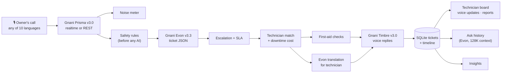

# 🛠️ MachineMitra — a voice repair line for small factories


> Built for the **Gnani AI Great Indian AI Internship Challenge 2026** by **Priya Singh** and **Mishita Joshi**.
> Uses **Gnani Prisma v3.0** (speech to text), **Gnani Timbre v3.0** (text to speech) and **Gnani Evon v3.3** (reasoning).

When a machine breaks down in a small factory, production stops and every hour costs money. The owner phones a
technician and describes the fault in rushed Hinglish or a regional language, often over shop-floor noise. The
technician arrives without knowing what's wrong, may bring the wrong parts, and has to come back.

**MachineMitra turns that phone call into a repair ticket in seconds** — and then manages the repair until the
machine runs again.

## Features

**On the call**

| Feature | What happens | Engine |
|---|---|---|
| Streaming transcription | Each phrase appears on screen as soon as Prisma recognises it (realtime WebSocket API); REST fallback for uploads | **Prisma v3.0** |
| Noise meter | Estimates the call's signal-to-noise ratio and shows how noisy it was | Python |
| Reply in the caller's language | Auto-detects any of 10 Indian languages (plus Hinglish) and answers in the same one | **Prisma** + **Timbre** |
| Safety-first alert | Sparks, smoke, gas or shock trigger a spoken "switch off the power" warning before any AI runs | Rules + **Timbre** |
| Diagnosis ticket | Machine, symptoms, likely causes, urgency, skills, parts, tools | **Evon v3.3** (labelled fallback if offline) |
| First-aid while you wait | Up to 3 safe checks the owner can do now; anything involving panels, wires or guards is blocked in code | **Evon** + filter |
| Escalation | Frustrated or repeat callers go to the most senior matching technician | Rules + **Evon** |
| Cost & impact | Downtime ₹/hour, loss until arrival, API cost of the call (under ₹1), call-to-ticket time | Python |
| Technician match | Nearest available technician with the right skills, with ETA | Python |
| Cross-language briefing | Hinglish call in, Tamil/Marathi/Bengali voice briefing out | **Evon** + **Timbre** |
| Voice follow-up | Missing details are asked by voice; the answer updates the same ticket | All three |

**After the call**

| Feature | What happens |
|---|---|
| Ticket lifecycle | Open → Assigned → On the way → On site → Fixed, with a full timeline per ticket |
| SLA timer | Arrival deadline by urgency (critical 2 h, high 4 h…), overdue tickets flagged |
| Technician voice updates | "Pahunch gaya, valve chahiye" → status changes and the owner hears the update in their language |
| Spoken service report | Technician speaks a 20-second summary → Evon writes a printable service report |
| QR sticker per machine | Scanning opens the app with that machine selected and its history attached |
| Repeat-fault memory | Flags machines that keep breaking and recommends preventive maintenance |
| Ask your history by voice | "Pichhli baar compressor kab kharab hua tha?" → Evon reads all past tickets and answers |
| Owner insights | Breakdowns per machine, downtime cost, SLA %, repeat faults |
| Evaluation page | Word error rate and ticket accuracy on quiet vs noisy vs 8 kHz phone audio |

Every ticket shows which engine produced it, and a pipeline trace shows each step's timing. Technicians, factories
and machines are **fictional demo data** (`data/`).

## Architecture



```
machinemitra/
├── app.py                  Streamlit entry point (sidebar + tabs)
├── config.py               settings from .env / Streamlit secrets
├── gnani/                  Prisma REST + realtime clients, Timbre client, audio chunking, errors
├── reasoner/               ticket schema, Evon client, prompts, workflows, rule-based fallback
├── core/                   pipeline, actions, db (SQLite), language, safety, firstaid, escalation,
│                           noise, sla, costs, matching, downtime, qr, budget
├── ui/                     one file per tab: report, board, machines, insights, ask, evaluation
├── data/                   demo technicians, factories, machines
├── notebooks/              evon_kaggle.ipynb — host Evon on a free Kaggle GPU
├── eval/                   run_eval.py + cases.csv (your recordings go in eval/audio/)
├── scripts/credit_test.py  measure credits per call
├── tests/                  30 tests — Gnani and Evon mocked, plus a fake Prisma WebSocket server
└── .github/workflows/      runs the tests on every push
```

## Run it locally

Needs Python 3.10+ and `ffmpeg` (Windows: `winget install ffmpeg`; macOS: `brew install ffmpeg`).

```bash
git clone https://github.com/OWNER/REPO && cd REPO
python -m venv .venv && .venv\Scripts\activate      # macOS/Linux: source .venv/bin/activate
pip install -r requirements.txt
copy .env.example .env                                # macOS/Linux: cp .env.example .env
# put your Gnani key in .env
python -m pytest -q                                   # 30 tests, no credits used
streamlit run app.py
```

Without `EVON_BASE_URL` the app still works end to end with the rule-based fallback (clearly labelled).

## Hosting Evon v3.3

Evon v3.3 is open weights and not on Gnani's API platform yet, so we host it ourselves:

1. Open `notebooks/evon_kaggle.ipynb` on Kaggle with **GPU T4 x2** and **Internet on**. Run the cells one by one.
2. It builds llama.cpp, downloads a 4-bit GGUF of Evon (community quantization
   `luminenio/gnani-evon-v3.3-30B-A3B-GGUF`), starts an OpenAI-compatible server protected by an API key, and opens a
   free Cloudflare tunnel.
3. Copy the printed `EVON_BASE_URL` and `EVON_API_KEY` into `.env` or Streamlit secrets.

Thinking is turned off (`chat_template_kwargs.enable_thinking = false`), as the model card recommends for structured
extraction. The tunnel URL changes whenever the notebook restarts.

## Deploy free on Streamlit Community Cloud

1. Push this repo to GitHub (`.env` is git-ignored).
2. share.streamlit.io → **Create app** → this repo, branch `main`, file `app.py`.
3. **Advanced settings → Secrets**: paste `.streamlit/secrets.toml.example` with real values (use a separate
   `machinemitra-prod` Gnani key, and set `APP_URL` to the app's link so QR stickers point to it).
4. Deploy. `packages.txt` installs ffmpeg automatically.

## Credits and cost

Measured on our Gnani usage page: Timbre costs about **0.0018 credits per character** (199 characters = 0.36
credits). A full call — transcription plus three spoken replies — costs **under ₹1**, against a typical
₹3,000–4,000 per hour of downtime.

Credit protection on the public link: per-visitor and daily caps (`MAX_RUNS_PER_SESSION`, `MAX_RUNS_PER_DAY`),
a 60-second limit per recording, and caching of every transcript and voice reply, so replays are free.

## Evaluation

Record the same complaints in a quiet room, on a noisy floor and on a phone, list them in `eval/cases.csv`, and run:

```bash
python eval/run_eval.py --phone
```

It reports word error rate, noise level (SNR) and ticket accuracy for each condition; the **Evaluation** tab charts
the results. Results: *to be filled in after recording.*

## Gnani models and APIs used

| Model | API | How |
|---|---|---|
| Gnani Prisma v3.0 | `POST https://api.vachana.ai/stt/v3` and `wss://api.vachana.ai/stt/v3/stream` | `model=prisma-v3.0`, `indic-auto` or language hints, `codemix`/`transliterate`, `keyterms`, `topic`, `previous_text`; realtime 1,024-byte PCM frames + `commit` |
| Gnani Timbre v3.0 | `POST https://api.vachana.ai/api/v1/tts/inference` | `model=timbre-v3.0`, voices Shivani/Avinash, all 10 languages plus `hi-en` Hinglish |
| Gnani Evon v3.3 | self-hosted, OpenAI-compatible `/v1/chat/completions` | ticket JSON, safe checks, translation, technician updates, service reports, history Q&A |

## Team

| Member | Contribution |
|---|---|
| Priya Singh | *to be filled in* |
| Mishita Joshi | *to be filled in* |

## Limitations

- Technicians, factories and machines are fictional demo data; dispatch is simulated.
- Streaming mode streams a recording through Prisma's realtime API at speaking speed; a live microphone stream from
  the browser would need WebRTC.
- The rule-based fallback is far less capable than Evon and cannot translate.
- Evon runs on a free GPU session, so it is not always online.
- The safety alert and first-aid tips are reminders, not a replacement for factory safety procedures.
- The disk on Streamlit Community Cloud resets on restart, so the demo database is temporary.

## License

MIT
